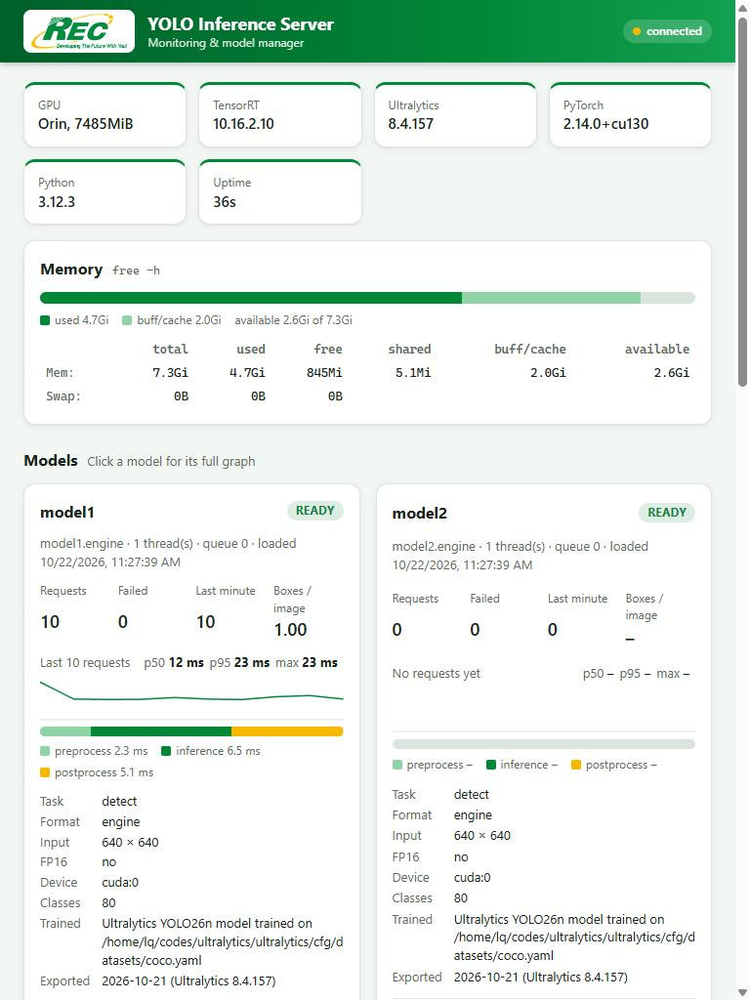
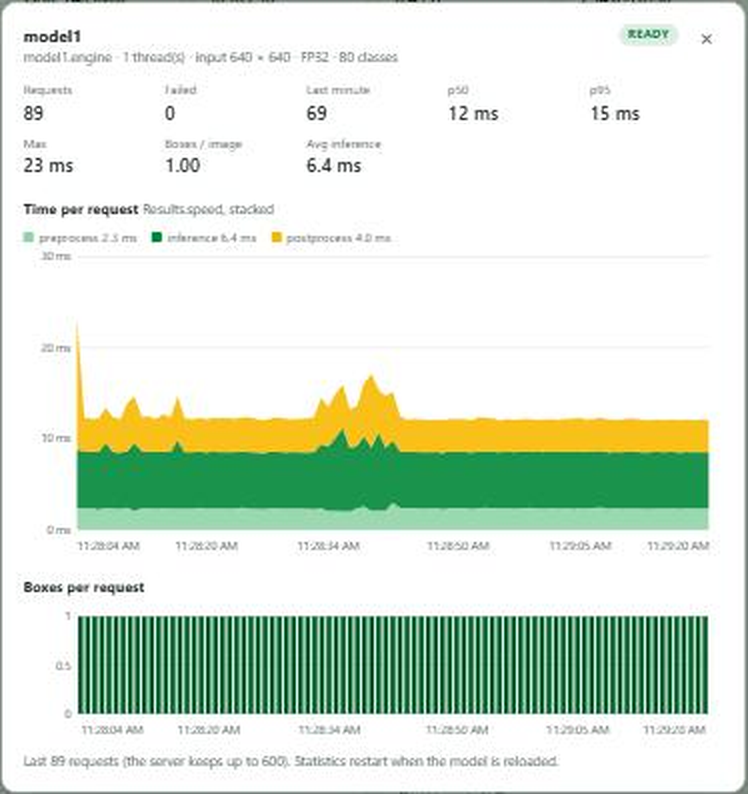

# yoloinferencewebserver

The web dashboard of the YOLO inference server on an NVIDIA Jetson: monitoring, model management, TensorRT
conversion and saved images, in the browser. A small Node.js (Express) server serves two pages and forwards their
requests to the inference server and the image server.



It is one of four repositories that work together:

| Repository | What it is | Runs on | Port |
| --- | --- | --- | --- |
| [yoloinferencemodel](https://github.com/CaptainAAI/yoloinferencemodel) | Inference server `server.py` | Jetson | 6767 |
| **yoloinferencewebserver** (this one) | Web dashboard | Jetson | 8080 |
| [yoloinferenceimageserver](https://github.com/CaptainAAI/yoloinferenceimageserver) | Image store | Jetson, local only | 6770 |
| [yoloinferencesdkcpp](https://github.com/CaptainAAI/yoloinferencesdkcpp) | C++ SDK for Windows programs | Windows PC | none |

## Contents

- [Requirements](#requirements)
- [Quick start](#quick-start)
- [Running it by hand](#running-it-by-hand)
- [Configuration](#configuration)
- [Models page](#models-page)
- [Images page](#images-page)
- [How it works](#how-it-works)
- [Files](#files)
- [deploy.sh](#deploysh)
- [Troubleshooting](#troubleshooting)

## Requirements

- Node.js 18 or newer and npm (tested: Node 24 on a Jetson Orin). One dependency: `express`.
- [yoloinferencemodel](https://github.com/CaptainAAI/yoloinferencemodel) running on the same Jetson (port 6767).
- Optional: [yoloinferenceimageserver](https://github.com/CaptainAAI/yoloinferenceimageserver) for the Images page.
- `free` (procps) and Python with `tensorrt` for the memory panel and the TensorRT version; both are on a Jetson.

## Quick start

On the Jetson:

```bash
git clone https://github.com/CaptainAAI/yoloinferencewebserver.git
cd yoloinferencewebserver
bash deploy.sh
```

Then open `http://<jetson-address>:8080`, e.g. `http://140.129.7.180:8080`. `deploy.sh` prints every address the
Jetson has.

To update later: `git pull && bash deploy.sh`. To make it start after a reboot: `bash deploy.sh --service`.

## Running it by hand

```bash
npm install
npm start                                                   # http://0.0.0.0:8080 -> server.py on 127.0.0.1:6767
PORT=8081 YOLO_API=http://127.0.0.1:6767 npm start          # other port / server
```

For development on a PC, point it at the Jetson: `YOLO_API=http://140.129.7.180:6767 npm start`, then open
`http://localhost:8080`. The Images page then only works with an image server reachable from the PC.

## Configuration

| Environment variable | Default | Meaning |
| --- | --- | --- |
| `PORT` | 8080 | Port of the dashboard (3000 is used by another app on the Jetson) |
| `YOLO_API` | `http://127.0.0.1:6767` | Address of `server.py` |
| `IMAGE_API` | `http://127.0.0.1:6770` | Image server address, used only while `server.py` cannot be asked; normally the address comes from `server.py`'s settings |
| `PYTHON` | `python3` | Python used to read the TensorRT version |

## Models page

`index.html` + `app.js`, refreshed every 2 s.

| Area | What you see and do |
| --- | --- |
| System | GPU, TensorRT, Ultralytics, PyTorch and Python versions, uptime |
| Memory | The Jetson's memory as `free -h` shows it, with a bar |
| Model cards | Status (ready, loading, reloading, error), file, threads, queue, requests, failures, last minute, boxes per image, p50 / p95 / max, a sparkline, the average time per stage, the model's info (task, format, input size, precision, device, classes, training data, export date). **Threads** + **Reload**, **Unload**, **Save images** |
| Full graph | Click a card: the last 600 requests' time, stacked by stage (preprocess, inference, postprocess), and boxes per request, with a tooltip per request |
| Load a model | Name, file, threads. The name is what clients send as `model_name` |
| TensorRT conversions | Status, duration and log of each conversion; Cancel |
| Model files | List, upload (`.engine`, `.pt`, `.onnx`, with progress), delete, **Convert to TensorRT** for `.pt` files (output name, height × width, FP16) |



Every model figure comes from Ultralytics through `server.py`. The memory and the TensorRT version are read by this
dashboard server (`GET /sys`), because `server.py` reports Ultralytics figures only.

## Images page

`images.html` + `images.js`. Needs the image server.

| Area | What you see and do |
| --- | --- |
| Saving images | The image server address (text field, saved in `server.py`), whether it is reachable, saved / not saved / waiting counters, a **Save images** switch per model |
| Image store | Image count, size, free disk, newest image |
| Filters | Model, class, with / without boxes, date from / to, id search, newest or oldest first; the page shows how many images match |
| Selection | A checkbox on each image (Shift-click selects a range), **Select shown**, **Select all matching** (also images not loaded yet) |
| Download | **Download N** as a zip: **YOLO dataset** (`images/`, `labels/`, `data.yaml`, ready for `yolo train data=data.yaml`; **Min score** leaves weak boxes out) or **Images only** |
| Delete | **Delete N** removes the selected images |
| Viewer | Click an image: the boxes drawn on it, a box table, Download, Delete, Selected; ‹ › or the arrow keys step through the images |

## How it works

`server.js` serves `public/` and forwards requests unchanged (streamed, so uploads and zips are not held in memory):

| Path | Goes to |
| --- | --- |
| `/api/*` | `server.py` (`/api/monitor` → `http://127.0.0.1:6767/monitor`) |
| `/images-api/*` | The image server at the address set in `server.py` (read every 3 s) |
| `/sys` | Answered here: `free -b` and `import tensorrt` |

When a server is down, the dashboard answers 502 `{"detail": "... not reachable at ..."}` and the page shows it.
The pages are plain HTML, CSS and JavaScript (no framework, no build step); every text from the servers is set with
`textContent`.

## Files

| File | Purpose |
| --- | --- |
| `server.js` | The Express server: static files, proxies, `/sys` |
| `package.json`, `package-lock.json` | npm package, dependency `express` |
| `public/index.html`, `public/app.js` | Models page |
| `public/images.html`, `public/images.js` | Images page |
| `public/style.css`, `public/logo.png` | REC theme (green `#008838`, yellow `#f8b800`), light and dark mode |
| `deploy.sh` | Install and restart on the Jetson |

## deploy.sh

| Command | What it does |
| --- | --- |
| `bash deploy.sh` | Checks Node and npm, copies the files to `~/yoloinferenceweb`, runs `npm install`, restarts it with `nohup`, prints the addresses and whether `server.py` and the image server are reachable. Survives logging out, not a reboot |
| `bash deploy.sh --service` | The same as a systemd service `yolo-dashboard` (starts after a reboot, restarts after a crash, log in `web.log`). Asks for your sudo password once |
| `bash deploy.sh --status` | Only shows what is running |

Settings: `WEB_DIR` (`~/yoloinferenceweb`), `WEB_PORT` (8080), `INFER_PORT` (6767).

## Troubleshooting

| Problem | Fix |
| --- | --- |
| The page does not open | `bash deploy.sh --status`; check the port and the firewall; see `~/yoloinferenceweb/web.log` |
| Badge says *server.py not reachable* | Deploy or start [yoloinferencemodel](https://github.com/CaptainAAI/yoloinferencemodel) |
| Images page says *image server not reachable* | Deploy [yoloinferenceimageserver](https://github.com/CaptainAAI/yoloinferenceimageserver), check the address on the page |
| TensorRT shows `–` | `python3 -c "import tensorrt"` fails for the user running the dashboard; set `PYTHON` |
| Port 8080 in use | `WEB_PORT=8081 bash deploy.sh` |

**Security:** there is no login. Anyone who can open the dashboard can unload models and delete files and images.
Keep it on a trusted network.
